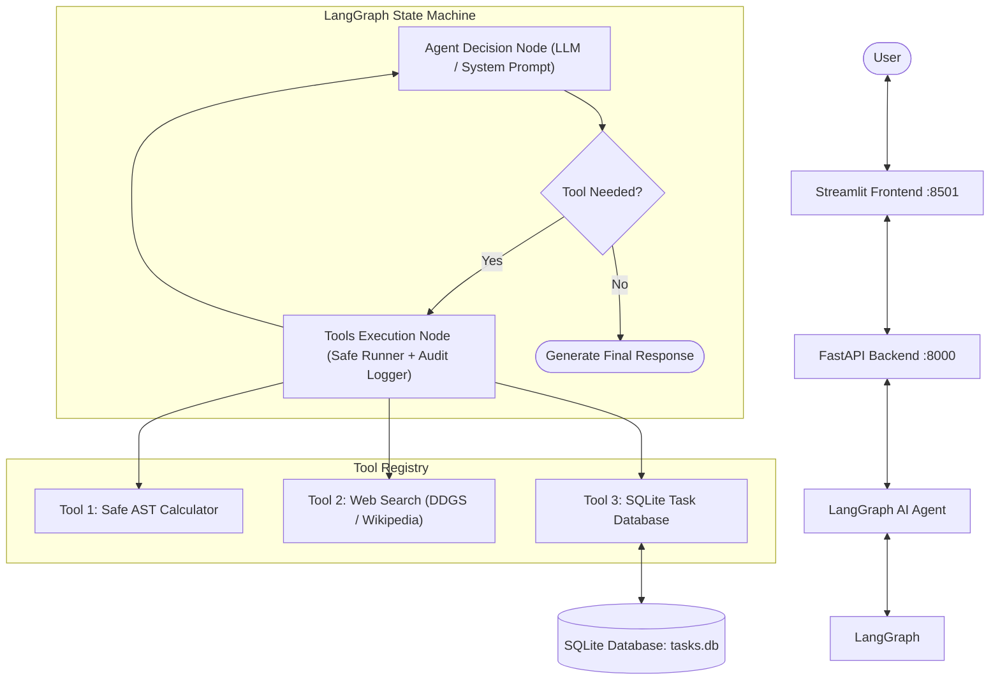

# 🤖 Multi-Tool AI Agent – Intelligent Task Assistant

> A production-ready, stateful multi-tool AI assistant built with **LangGraph**, **FastAPI**, **SQLite**, and **Streamlit**.  
> The agent autonomously receives natural language instructions, reasons over available capabilities, selects and executes the appropriate tool(s), maintains conversational memory, and synthesizes clear, actionable responses.

---

## 📑 Table of Contents
1. [Project Overview](#-project-overview)
2. [Architecture & Workflow](#-architecture--workflow)
3. [Technologies Used](#-technologies-used)
4. [The Three Core Tools](#-the-three-core-tools)
5. [LangGraph Agent Architecture](#-langgraph-agent-architecture)
6. [Project Directory Structure](#-project-directory-structure)
7. [Getting Started & Installation](#-getting-started--installation)
8. [Running the Application](#-running-the-application)
9. [REST API Documentation](#-rest-api-documentation)
10. [Safety, Reliability & Guardrails](#-safety-reliability--guardrails)
11. [Running Tests](#-running-tests)
12. [Docker Deployment](#-docker-deployment)

---

## 🌟 Project Overview

Traditional LLM applications simply generate text based on static training weights. In contrast, this **Multi-Tool AI Agent** actively decides **whether** and **which** external tools to invoke to accomplish dynamic tasks:

- **Mathematical Inquiries** (*e.g., "What is 25% of 800?" or "Calculate 120 × 45"*): Evaluated by the **Calculator Tool** using deterministic AST arithmetic rather than approximate LLM mental math.
- **Up-to-date Knowledge & Facts** (*e.g., "Find information about Retrieval-Augmented Generation"*): Retrieved by the **Web Search Tool** with live snippets, titles, and sources.
- **Task & Schedule Management** (*e.g., "Add a task to learn LangGraph tomorrow" / "Retrieve my saved tasks"*): Persisted and queried in an **SQLite Database** through structured CRUD operations.
- **General Conversation** (*e.g., "Hello, who are you?"*): Answered directly without invoking unnecessary tools.

---

## 🏛 Architecture & Workflow

### End-to-End System Diagram



### ASCII Architecture

```
                 USER
                   |
                   v
             Streamlit UI (:8501)
                   |
                   v
              FastAPI (:8000)
                   |
                   v
              AI AGENT (LangGraph)
                   |
            Agent Decision
                   |
       ---------------------------------
       |               |               |
       v               v               v
  Calculator      Search Tool    Database Tool
  (Safe AST)       (Web DDG)      (SQLite CRUD)
       |               |               |
       ---------------------------------
                   |
                   v
            Tool Result Trace
                   |
                   v
          LLM Final Response
                   |
                   v
                 USER
```

---

## 🛠 Technologies Used

| Technology | Purpose |
|---|---|
| **Python 3.12+** | Core programming language |
| **LangGraph** | Stateful multi-actor agent orchestration, cyclic graphs, checkpointer memory |
| **LangChain Core** | Tool definitions, schemas, and LLM interfaces |
| **FastAPI** | High-performance asynchronous REST API backend |
| **Pydantic V2** | Strict data validation, schema enforcement, and serialization |
| **SQLite & SQLAlchemy** | Persistent local task storage and tool audit logging |
| **Streamlit** | Interactive chat interface, live task manager dashboard, and tool trace inspector |
| **DuckDuckGo Search** | Live web search without requiring paid API keys |
| **Pytest** | Automated unit and integration test suite |
| **Docker & Docker Compose**| Containerized deployment for backend and frontend |

---

## 🧰 The Three Core Tools

### 1. Calculator Tool (`app/tools/calculator.py`)
- **Purpose**: Computes mathematical operations deterministically using Python's `ast` (Abstract Syntax Tree) module.
- **Safety**: Rejects arbitrary code execution (`eval` is never used); handles division/modulo by zero safely.
- **Natural Language Support**: Parses expressions like `25% of 800`, `15% of 2,500`, `sqrt(144) + 12`, `120 * 45`, `2^8`.

### 2. Information Search Tool (`app/tools/search.py`)
- **Purpose**: Retrieves live information, definitions, and external articles.
- **Resilience**: Primary search uses DuckDuckGo; automatically falls back to Wikipedia API if DuckDuckGo is rate-limited or blocked.
- **Output**: Returns structured title, snippet, and source URL citations.

### 3. Task Database Tool (`app/tools/task_tool.py`)
- **Purpose**: Persistent task and to-do list tracking via SQLite.
- **Supported Operations**:
  - `add_task(title, description, priority, due_date)`
  - `list_tasks(status, priority, limit)`
  - `complete_task(task_id)`
  - `delete_task(task_id, confirm)` *(Requires explicit confirmation to prevent accidental loss)*

---

## 🔄 LangGraph Agent Architecture

The agent workflow is structured as a state machine using LangGraph:

1. **State Schema (`AgentState`)**:
   - `messages`: Message history (`SystemMessage`, `HumanMessage`, `AIMessage`, `ToolMessage`).
   - `session_id`: Unique session string for state persistence.
   - `tool_calls_trace`: List of tool executions with timings and inputs/outputs.
   - `iteration_count`: Recursion counter to avoid infinite loops.
2. **Nodes**:
   - **`agent` node**: Evaluates messages against bound tools and generates tool calls or text.
   - **`tools` node**: Dispatches tool calls to registered Python functions, captures exceptions, logs execution time, and records an audit log to SQLite.
3. **Edges & Routing (`should_continue`)**:
   - If the last message contains `tool_calls` and `iteration_count < MAX_AGENT_ITERATIONS` ➔ routes to `tools`.
   - If no tool calls are needed ➔ routes to `END`.
4. **Conversational Memory**:
   - Uses `MemorySaver` checkpointer keyed by `thread_id=session_id`, allowing multi-turn dialogues where the assistant remembers previous tasks, calculations, and answers.

---

## 📂 Project Directory Structure

```
Multi-Tool-AI-Agent/
├── app/
│   ├── __init__.py
│   ├── main.py                     # FastAPI application entrypoint & middleware
│   ├── core/
│   │   ├── __init__.py
│   │   ├── config.py               # Pydantic Settings & environment variables
│   │   └── logging.py              # Centralized logging setup
│   ├── db/
│   │   ├── __init__.py
│   │   ├── database.py             # SQLite engine & sessionmaker
│   │   ├── models.py               # SQLAlchemy models (Task, ToolAuditLog)
│   │   └── crud.py                 # Task & audit log CRUD operations
│   ├── schemas/
│   │   ├── __init__.py
│   │   ├── task.py                 # Pydantic schemas for Tasks
│   │   ├── chat.py                 # Pydantic schemas for Chat & Tool Traces
│   │   └── tool_models.py          # Structured Pydantic tool input models
│   ├── tools/
│   │   ├── __init__.py
│   │   ├── calculator.py           # Safe AST Calculator tool
│   │   ├── search.py               # DuckDuckGo & Wikipedia search tool
│   │   ├── task_tool.py            # SQLite task management tool functions
│   │   └── registry.py             # LangChain tool registry & metadata
│   ├── agent/
│   │   ├── __init__.py
│   │   ├── state.py                # LangGraph AgentState TypedDict
│   │   ├── prompts.py              # System prompt and tool guidelines
│   │   ├── llm.py                  # Multi-provider LLM factory & MockAgent
│   │   └── workflow.py             # LangGraph StateGraph builder & router
│   └── api/
│       ├── __init__.py
│       ├── routes_chat.py          # POST /api/chat
│       ├── routes_tasks.py         # CRUD endpoints for tasks
│       └── routes_tools.py         # GET /api/tools & /api/tools/audit-logs
├── frontend/
│   └── app.py                      # Interactive Streamlit UI application
├── tests/
│   ├── __init__.py
│   ├── test_calculator.py          # Calculator math & safety tests
│   ├── test_tasks_db.py            # SQLite CRUD & safety guardrail tests
│   ├── test_search.py              # Search tool tests
│   ├── test_agent_workflow.py      # LangGraph state machine & routing tests
│   └── test_api.py                 # FastAPI endpoint integration tests
├── data/                           # Persistent SQLite database directory
├── run.py                          # Unified service runner (backend / frontend / both)
├── Dockerfile                      # Production Docker container image
├── docker-compose.yml              # Multi-container orchestration
├── render.yaml                     # Cloud deployment configuration
├── requirements.txt                # Python package dependencies
├── .env.example                    # Environment variable template
└── README.md                       # Comprehensive project documentation
```

---

## 🚀 Getting Started & Installation

### 1. Prerequisites
- Python 3.11, 3.12, or 3.13 installed
- Git

### 2. Clone Repository & Setup Virtual Environment
```bash
git clone <repository_url>
cd sentrix-main/Multi-Tool-AI-Agent

# Create virtual environment
python -m venv .venv

# Activate virtual environment
# Windows (PowerShell):
.\.venv\Scripts\Activate.ps1
# Linux / macOS:
source .venv/bin/activate

# Install dependencies
pip install -r requirements.txt
```

### 3. Environment Configuration
Copy the sample environment file:
```bash
cp .env.example .env
```
Open `.env` and set your preferred provider (`groq`, `openai`, or `google`) and your API key:
```env
LLM_PROVIDER=groq
GROQ_API_KEY=gsk_your_groq_api_key_here
```
> **Note:** If no API key is provided, the application automatically uses the built-in deterministic **Mock Agent**, allowing 100% of features (calculator, web search, task database, and chat) to be tested completely offline!

---

## 🏃 Running the Application

### Option A: Launch Both Backend & Frontend Simultaneously
```bash
python run.py both
```
- **Streamlit Frontend**: [http://localhost:8501](http://localhost:8501)
- **FastAPI Backend**: [http://localhost:8000](http://localhost:8000)
- **Interactive Swagger Docs**: [http://localhost:8000/docs](http://localhost:8000/docs)

### Option B: Run Services Separately
Terminal 1 (Backend API):
```bash
python run.py backend --port 8000
```
Terminal 2 (Frontend UI):
```bash
python run.py frontend --port 8501
```

---

## 📡 REST API Documentation

### 1. Agent Chat Endpoint
**`POST /api/chat`**
```bash
curl -X POST "http://localhost:8000/api/chat" \
  -H "Content-Type: application/json" \
  -d '{
    "message": "What is 25% of 800?",
    "session_id": "user_session_1"
  }'
```
**Response:**
```json
{
  "response": "Based on the calculation, the result is: 200.",
  "session_id": "user_session_1",
  "tool_calls": [
    {
      "tool_name": "calculator",
      "tool_input": {"expression": "25% of 800"},
      "tool_output": "200",
      "status": "success",
      "execution_time_ms": 2.15
    }
  ],
  "model_used": "groq",
  "iteration_count": 2
}
```

### 2. Task Management Endpoints
- `GET /api/tasks` – List tasks (supports `?status=Pending` and `?priority=High`)
- `POST /api/tasks` – Create task (`{"title": "Learn LangGraph", "priority": "High", "due_date": "Tomorrow"}`)
- `GET /api/tasks/{task_id}` – Retrieve single task
- `PUT /api/tasks/{task_id}` – Update task properties
- `POST /api/tasks/{task_id}/complete` – Mark task complete
- `DELETE /api/tasks/{task_id}?confirm=true` – Permanently delete task

### 3. Tool Discovery & Health
- `GET /api/tools` – Inspect all registered tools and their input schemas
- `GET /api/tools/audit-logs` – View tool execution history and latencies
- `GET /health` – System health check

---

## 🛡 Safety, Reliability & Guardrails

1. **AST-Based Math Safety**: Prevents arbitrary code execution by validating Python AST nodes and whitelisting mathematical operators and standard functions.
2. **Deletion Confirmation**: Destructive actions like `delete_task` require `confirm=True`, preventing unauthorized or accidental deletion.
3. **Loop & Recursion Limits**: Agent workflow terminates after a maximum number of steps (`MAX_AGENT_ITERATIONS = 10`) to safeguard against infinite cyclic tool loops.
4. **Pydantic Validation**: All API inputs, tool parameters, and task schemas are strictly validated against Pydantic models.
5. **Tool Execution Audit Logging**: Every tool invocation, along with its input arguments, result, execution latency, and session ID, is persisted to SQLite table `tool_audit_logs`.

---

## 🧪 Running Tests

Run the full automated test suite using `pytest`:
```bash
pytest tests -v
```

**Test Coverage Summary:**
- `tests/test_calculator.py`: Arithmetic, percentage parsing, division by zero, modulo, square roots, AST security.
- `tests/test_tasks_db.py`: Task creation, completion, deletion guardrails, ID lookups.
- `tests/test_search.py`: Query handling, fallback resilience.
- `tests/test_agent_workflow.py`: LangGraph tool routing, conditional edges, multi-turn state.
- `tests/test_api.py`: FastAPI endpoints, status codes, Pydantic responses.

---

## 🐳 Docker Deployment

Build and start both services in isolated containers:
```bash
# Build and start services
docker compose up --build

# Stop services
docker compose down
```
Access the application:
- Frontend: `http://localhost:8501`
- Backend API Docs: `http://localhost:8000/docs`

---

## 📄 License
MIT License. Built for the **Multi-Tool AI Agent – Intelligent Task Assistant** curriculum.
